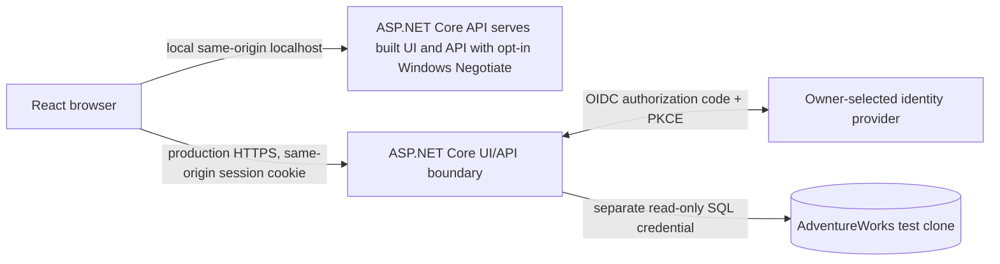

# Authentication and Authorization

**Status:** Project Owner accepted the same-origin OIDC BFF as the production target on 2026-10-27. Provider, staff group/data scope, and deployment approvals are still pending; production authentication is not implemented.

## Recommendation

Use the ASP.NET Core API as a small backend-for-frontend (BFF) for production authentication. The Project Owner accepted this architecture recommendation; selection and provisioning of a standard OIDC provider remain with Identity/IT. The provider authenticates staff through authorization code flow with PKCE. The server handles the callback and creates an ASP.NET Core authentication session; React calls the API on the same origin using that session cookie. Do not return OAuth/OIDC access or refresh tokens to React or store them in browser storage. The database read-only identity remains a separate server-side SQL credential and is never evidence of a web user's identity.

Keep production UI and API on one HTTPS origin, with ASP.NET Core hosting the built UI or a reverse proxy routing both paths to their respective processes. This avoids browser CORS credentials configuration and makes cookie-based API calls straightforward. The provider is not selected or confirmed available by this recommendation.

For local development, use ASP.NET Core Negotiate only when the explicit Development opt-in is enabled. Negotiate authenticates the Windows HTTP caller; the API must not derive caller identity from `WindowsIdentity.GetCurrent()` or accept identity from a request header, token, or process identity. Per Project Owner approval for this local POC, every successfully Windows-authenticated caller receives the `InternalStaff` policy claim; no additional group mapping is implied. Keep the opt-in Development-only, reject startup if enabled elsewhere, and retain the configured and runtime loopback-listener guard. The selected local workflow builds React into the API's `wwwroot` and serves the UI and API on the same loopback origin; Vite is not an authenticated API proxy. This is a local-development convenience, not production sign-in or evidence of provider availability. API integration tests use a deterministic test-only authentication handler, never the live Negotiate mechanism.

## Boundaries and protections

- Require authentication and the `InternalStaff` authorization policy on every business API route, including product catalog routes as well as customer, address, order-options, and future order routes. Apply a fallback policy so newly added endpoints are protected by default. Allow anonymous access only to an explicitly identified, non-sensitive liveness endpoint.
- Map the provider's verified issuer-specific group or role claim to the application policy `InternalStaff`. The provider's trusted claim name, group identifier, and mapping must be approved before configuration. Do not authorize from a display name, email domain, client-supplied header, or SQL principal. Do not invent administrator roles or per-customer access rules; add narrower policies only if the product owner approves them.
- Anonymous requests to protected routes return `401`; an authenticated identity without the staff policy returns `403`. Enforce this in the API, not only in React. Treat all identifiers and filters as untrusted input and keep the existing parameterized SQL and bounded result behavior.
- Configure the production session cookie as `Secure`, `HttpOnly`, `SameSite=Lax`, host-only, and narrowly scoped to `/`. Use TLS throughout. Protect ASP.NET Core Data Protection keys across restarts/instances with the deployment-approved secret store and access controls. Set an approved idle/absolute session lifetime; logout clears the local session and may also initiate provider sign-out. Do not put bearer tokens or SQL credentials in cookies, JavaScript, or browser storage.
- Keep production same-origin and do not enable credentialed CORS by default. If a separately hosted origin becomes an explicit requirement, approve exact origins and credential behavior as a separate change; wildcard origins are not acceptable with credentials.
- Current business endpoints are GET-only. Keep GET/HEAD/OPTIONS free of state changes. Before adding any browser-callable state-changing route, including the loopback POC route, require ASP.NET Core antiforgery validation with a request token sent in a custom header; loopback, CORS, or `SameSite` alone is not CSRF protection. For production cookie-authenticated routes, apply this in addition to `SameSite`; protect login/callback using the OIDC middleware's state, nonce, and correlation checks.
- Keep `/api/health` anonymous only as a minimal liveness response that reveals no identity, environment, database, configuration, or dependency status. If readiness/dependency health is added, expose it only on an internal/operator boundary and return no secrets or detailed database errors.

## Local and production flow

The local API now serves the built React UI from `wwwroot` with the `InternalStaff` policy and uses the same localhost origin for UI and API requests. The integrated-browser check loaded the UI and reached an order endpoint, which returned the expected sanitized 503 with SQL credentials intentionally unavailable; no database connection or data query occurred. See the [local runbook](../runbooks/development-and-test-safety.md) for the verified workflow and limits.

The production server validates the OIDC response and its issuer, signature, audience/client, state, nonce, and callback. It issues the application session only after the provider identity maps to `InternalStaff`. The SQL adapter continues to enforce its own least-privilege database permissions; authorization failure must not fall through to a SQL call.

## Alternatives and consequences

The alternative is a React SPA using OAuth authorization code with PKCE and sending short-lived bearer tokens to the API. It is a standard option when UI and API must remain separately hosted, but it puts access tokens in the browser's security boundary and requires explicit CORS, token renewal, storage, and API audience configuration. Prefer the BFF for this internal tool unless hosting constraints require separate origins. Do not build a custom production username/password or token-issuing system.

The local Negotiate setup intentionally does not prove production federation, approved staff-group mapping, sign-out, or session revocation. Windows default-credential UI availability and browser Negotiate behavior must be checked against the actual API-origin `localhost` workflow; API tests use a test-only scheme and do not prove browser negotiation. Test provider-specific details only after the identity owner supplies a provider and application registration. If immediate session revocation is required, decide whether a server-side ticket store or provider-backed session controls are needed; it is not assumed here.

## Owners, dependencies, and acceptance checks

### Decision packet to unblock production read access

The Project Owner should record one explicit data-scope decision for the initial internal staff audience:

- Which named internal group may use the application, as supplied by Identity/IT; do not infer a group from email domain or display name.
- Whether that group may search the full customer catalog, or whether customer visibility must be restricted by a documented business boundary.
- Whether authorized users may retrieve linked billing/shipping address options and ship methods for a selected customer, in addition to the current minimal customer search fields.
- Whether all members of that group share the same scope or any approved narrower role distinction is required. Do not invent administrator or customer-specific rules.

Identity/IT supplies the provider and verified issuer-specific staff claim mapping. Deployment/platform supplies the HTTPS origin, callback/logout URLs, protected Data Protection key-store design, and operational session lifetime. Security reviews the assembled mapping, scope, session controls, logout/revocation expectations, and logging boundary. These inputs are independent approvals; recording the target BFF architecture does not provide any of them.

The first production read release should expose only the routes and DTO fields needed by the approved scope. If customer visibility or address eligibility cannot be established for a request, deny it; do not broaden access to make the workflow appear complete. Until the decisions and implementation checks below are complete, keep production business APIs unavailable and retain the loopback-only Development identity for local testing.

1. **Identity/IT owner:** select and confirm availability of the OIDC provider; provision the application registration; approve issuer, client/audience, redirect and logout URIs, scopes, trusted staff group/role claim and identifier, and credential/key custody and rotation. No provider is asserted to be available.
2. **Project Owner:** approve which internal staff group is authorized for this tool and confirm whether all such staff may see all customer/address records. The existing policy approves authenticated internal staff, but does not define the provider group or finer data scope.
3. **Deployment/platform owner:** approve the same-origin HTTPS routing, callback DNS/URLs, production secret and Data Protection key storage, and session lifetime/operational logging boundary.
4. **API Engineer:** implement default-deny authentication/authorization, opt-in Development Negotiate from the actual Windows HTTP caller, OIDC/cookie setup from approved configuration, anonymous liveness metadata, and the tests below. Do not enable a production identity configuration until owner inputs are supplied.

Acceptance checks:

- Every business API route, including products and customer/order routes, returns `401` anonymously and `403` for an authenticated non-staff identity; a policy-authorized identity reaches the normal route behavior.
- Liveness remains anonymous and returns only its minimal status. Test health/readiness separately if a readiness route is introduced.
- Development Negotiate authentication is opt-in, only activates in `Development`, cannot be enabled in another environment, and retains the loopback listener guard. A successful Negotiate caller reaches the local POC `InternalStaff` policy; unauthenticated calls receive `401`. API tests use a deterministic test-only scheme; browser/Vite/Negotiate interoperability is verified separately.
- Cookie flags and expiry are verified by tests/configuration checks; production endpoints require HTTPS. Same-origin deployment works without permissive CORS.
- OIDC callback/state/nonce failures do not establish a session; logout clears the local session. Provider integration tests are added only after provider registration exists.
- Cookie-authenticated mutation tests reject missing/invalid antiforgery tokens before any write occurs. Until then, business routes remain read-only GETs.
- Tests prove authorization is decided from the web identity and that SQL is not called for unauthorized requests. The SQL test identity remains read-only and is never reused as a staff identity.